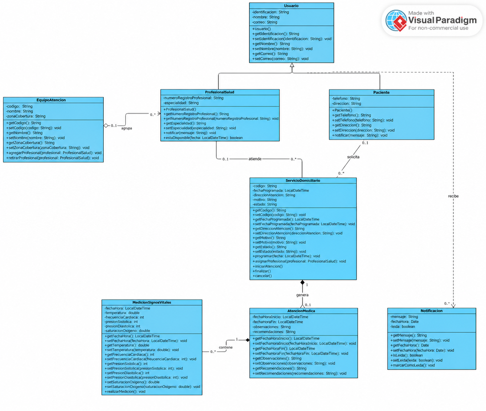

# Taller MediHome - Diseño y Programación

**Integrantes:**
- Andrés Bolaños

**Descripción:**
Este proyecto consiste en el diseño e implementación de un sistema de gestión para la empresa **MediHome**, una entidad dedicada a la prestación de servicios de atención médica domiciliaria. El objetivo principal es administrar de manera eficiente la información de los pacientes, los profesionales de la salud y los servicios que se prestan a domicilio.

El sistema ha sido modelado utilizando **UML (Lenguaje Unificado de Modelado)** y desarrollado en **Java**, aplicando los principios de la Programación Orientada a Objetos como herencia, encapsulamiento, composición y asociación.

## Funcionalidades Modeladas

El diagrama de clases incluye las siguientes entidades y relaciones:

- **Usuario (Clase base):** Contiene los atributos comunes de identificación, nombre y correo electrónico. De esta clase heredan los Pacientes y los Profesionales de la Salud.
- **Paciente:** Representa a los usuarios que solicitan servicios domiciliarios. Incluye teléfono y dirección principal.
- **ProfesionalSalud:** Representa a los médicos y enfermeros que atienden los servicios. Incluye número de registro profesional y especialidad.
- **EquipoAtencion:** Organiza a los profesionales en equipos de trabajo, cada uno con un código, nombre y zona de cobertura.
- **ServicioDomiciliario:** Representa la solicitud de un servicio, con fecha programada, dirección, motivo y estado (Asociado, Programado, Atención, Finalizado, Cancelado).
- **AtencionMedica:** Registra la atención prestada por el profesional, incluyendo observaciones clínicas y recomendaciones.
- **MedicionSignosVitales:** Almacena las mediciones tomadas durante la atención (temperatura, frecuencia cardíaca, presión arterial y saturación de oxígeno).
- **Notificacion:** Permite a los usuarios recibir mensajes relacionados con los servicios.

## Diagrama de Clases
